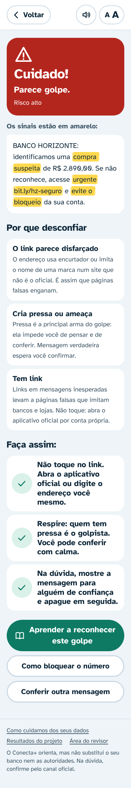

# Conecta+

**Aprender a usar o celular com calma e não cair em golpe.**

O Conecta+ é um app web para pessoas com 60 anos ou mais. Ele ensina a usar o celular com treinos que não têm risco de errar, confere se uma mensagem é golpe e explica, em linguagem simples, os golpes mais comuns e os mais novos.

**Acesse:** https://conecta-nznk.onrender.com

> No plano gratuito do Render, o primeiro acesso depois de um tempo parado pode levar até 1 minuto para abrir.

<p>
  
  
  
</p>

---

## Equipe

| Nome completo | RM |
| --- | --- |
| [Debora da Silva Amaral] | [550412] |
| [Eduardo Pielich] | [99767] |
| [Livia Namba Seraphim] | [97819] |

Global Solution 2026.2, FIAP — Engenharia de Software, desafio CitizenTech.

---

## Ficha técnica do MVP

| Item | Descrição |
| --- | --- |
| **Nome** | Conecta+ |
| **Cidadão** | Pessoa com 60 anos ou mais que usa WhatsApp e app de banco no celular e tem pouca prática com o digital |
| **Problema** | 74,5% das pessoas com 60+ já usam a internet ([PNAD TIC/IBGE](https://teletime.com.br/02/07/2026/usuarios-internet-brasil-ultrapassa-90/)), mas só 2,6% têm habilidade digital acima do básico ([Anatel](https://dplnews.com/?p=335489)). Em São Paulo, 82% dos idosos já receberam tentativa de golpe ([Fundação Seade](https://tiinside.com.br/12/03/2026/em-sao-paulo-82-dos-idosos-sofreram-tentativas-de-golpes-virtuais/)). |
| **Proposta de valor** | Ensinar a usar o celular praticando sem risco, conferir mensagens suspeitas e transformar cada dúvida numa aula curta, com o aprendizado medido |
| **Modelo de negócio** | B2B2C: grátis para a pessoa idosa, licença mensal paga por cooperativas de crédito, que recebem um relatório de impacto anônimo |
| **Arquitetura** | Monólito em Python (FastAPI) servindo páginas HTML, CSS e JavaScript; SQLite; container Docker publicado no Render |
| **Fontes de dados** | Conteúdo didático próprio (lições, aulas, 12 golpes conhecidos); alertas de golpe de portais oficiais, aprovados por uma pessoa; eventos de uso anônimos |
| **IA e regras** | Verificador por motor de regras explicável (sem IA generativa): cada sinal de golpe tem peso e explicação, sem custo por consulta e sem enviar o texto a terceiros |
| **Indicadores** | Ganho de conhecimento (acerto no teste final menos o acerto no teste inicial), lições do celular concluídas, mensagens conferidas, conferências que viraram aula |
| **ODS** | 4 (Educação de qualidade), 10 (Redução das desigualdades) e 16 (Paz, justiça e instituições eficazes) |
| **URL** | https://conecta-nznk.onrender.com |

---

## O que dá para fazer

### Aprender o celular — Nível 1, primeiros passos

| Lição | Como funciona |
| --- | --- |
| Treinar o toque | Treina tocar, segurar e arrastar |
| Mandar áudio | Simulador: achar a conversa, segurar o microfone, falar e soltar |
| Copiar e colar | Simulador: segurar, copiar, segurar e colar (é o que a pessoa precisa para conferir uma mensagem) |
| Letra maior, Ligar e atender, Volume, Chamada de vídeo, Bloquear número, Conecta+ na tela | Passo a passo com versão para Android e para iPhone. O app descobre qual é o celular e a pessoa pode trocar |

Nos treinos, nada é enviado de verdade.

### Entender e se proteger — Nível 2

- Teste rápido no começo, para saber o que a pessoa já sabe
- Aulas "O que é um link" e "Senha forte"
- Quatro aulas de golpe: falso aviso do banco, parente com número novo, pedido de código e prêmio falso
- Teste final, que mede o ganho de conhecimento

### É golpe?

A pessoa toca em **Colar a mensagem** ou cola o texto na caixa. O app responde "Cuidado! Parece golpe.", "Atenção!", "Poucos sinais" ou "Não deu para saber", marca em amarelo os trechos suspeitos, explica por que desconfiar e diz o que fazer. Depois indica a aula do golpe e a lição de bloquear o número.

### Golpes

- **Golpes novos:** avisos coletados em portais oficiais e publicados só depois de aprovados por uma pessoa na tela de revisão
- **Os golpes de sempre:** 12 golpes explicados, cada um com um exemplo de mensagem, o truque e o que fazer

### Para todo mundo

- Letra de 22 px, com o botão **AA** para aumentar em três tamanhos
- Botão **Ouvir**, que lê a tela em voz alta
- "Voltar" escrito em toda tela
- O amarelo sempre quer dizer "olhe aqui"

---

## Privacidade

- O app não tem cadastro.
- A mensagem conferida é analisada e descartada na hora. Ela não fica guardada, e os links dela nunca são abertos.
- O app guarda só contagens, como "acertou 2 de 3", ligadas a um número aleatório criado no aparelho. Não guarda nome, telefone nem e-mail.
- A pessoa apaga tudo em **Como cuidamos dos seus dados → Apagar meus dados**.
- A fonte Atkinson Hyperlegible é servida pelo próprio app: nenhuma página faz pedidos a terceiros.

---

## Como rodar no seu computador

Precisa do **Python 3.10 ou mais novo**.

### Windows (PowerShell)

```powershell
cd app
python -m venv .venv
Set-ExecutionPolicy -Scope Process Bypass
.\.venv\Scripts\Activate.ps1
pip install -r requirements-dev.txt
python -m pytest tests -q

cd src\app_alertas
$env:DATABASE_PATH="..\..\dados.sqlite3"
$env:ADMIN_USUARIO="revisor"
$env:ADMIN_SENHA="troque-esta-senha"
$env:RPA_API_TOKEN="troque-este-token"
uvicorn main:app --reload
```

### Mac ou Linux

```bash
cd app
python3 -m venv .venv
source .venv/bin/activate
pip install -r requirements-dev.txt
python -m pytest tests -q

cd src/app_alertas
export DATABASE_PATH=../../dados.sqlite3
export ADMIN_USUARIO=revisor
export ADMIN_SENHA=troque-esta-senha
export RPA_API_TOKEN=troque-este-token
uvicorn main:app --reload
```

Abra http://localhost:8000.

### Com Docker

```bash
cd app
docker build -t conecta-mais .
docker run -p 8000:8000 -e ADMIN_USUARIO=revisor -e ADMIN_SENHA=troque-esta-senha conecta-mais
```

---

## Publicação no Render

| Configuração | Valor |
| --- | --- |
| Tipo | Web Service, ambiente Docker |
| Root Directory | `app` |
| Dockerfile Path | `./Dockerfile` |
| Health Check Path | `/saude` |

| Variável de ambiente | Para que serve |
| --- | --- |
| `ADMIN_USUARIO` e `ADMIN_SENHA` | Login da tela de revisão de alertas (`/revisao`) |
| `RPA_API_TOKEN` | Token que um robô usa para enviar rascunhos de alertas |
| `APP_NOME` | Nome exibido (padrão: `Conecta+`) |
| `ALERTAS_DEMONSTRACAO` | `0` desliga os 4 alertas de demonstração que aparecem com o banco vazio |

O Render define a `PORT` sozinho. No plano gratuito, o disco é apagado a cada novo deploy.

---

## Testes

```bash
cd app
python -m pytest tests -q
```

São 90 testes automáticos. Eles cobrem:
- o verificador, com 20 mensagens de gabarito;
- as lições, as aulas e o catálogo de golpes;
- a revisão humana dos alertas;
- os eventos anônimos e a página de resultados;
- a privacidade: um teste confere que o texto conferido não vai para o banco nem para os logs;
- os links: um teste segue cada link das telas principais e confere que nenhum leva a uma página quebrada.

---

## Estrutura

```
app/
├── Dockerfile
├── requirements.txt
├── requirements-dev.txt
├── src/app_alertas/
│   ├── main.py            # app FastAPI, alertas e revisão
│   ├── rotas_mvp.py       # verificador, aulas de golpe, testes, eventos, resultados
│   ├── rotas_v2.py        # lições do celular, aulas do Nível 2, golpes
│   ├── verificador.py     # motor de regras explicável
│   ├── eventos.py         # contagens anônimas e indicadores
│   ├── banco.py           # alertas em SQLite
│   ├── conteudo/          # lições, aulas e golpes em JSON
│   ├── templates/         # telas (Jinja2)
│   └── static/            # CSS, JavaScript, fontes e ícones
└── tests/
assets_mvp/                # prints das telas
```

---

## Endereços principais

| Endereço | Tela |
| --- | --- |
| `/` | Início |
| `/aprender` | Lições do Nível 1 e aulas do Nível 2 |
| `/verificar` | É golpe? |
| `/golpes` | Golpes novos e de sempre |
| `/impacto` | Resultados do projeto (dados anônimos) |
| `/privacidade` | Como cuidamos dos seus dados |
| `/revisao` | Revisão de alertas (com login) |
| `/saude` | Verificação de funcionamento |

O Conecta+ orienta, mas não substitui o banco nem as autoridades. Na dúvida, confirme sempre pelo canal oficial.
