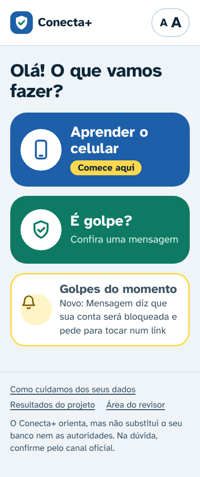
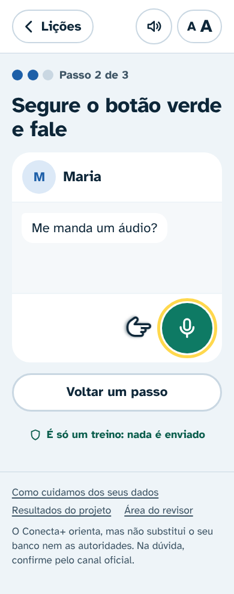

# Conecta+

### Tecnologia para aprender, autonomia para se proteger.

O **Conecta+** é uma aplicação web desenvolvida para pessoas com 60 anos ou mais que desejam utilizar o celular com mais autonomia e segurança.

A plataforma transforma dúvidas do cotidiano digital em oportunidades de aprendizado. Por meio de simulações sem risco, aulas práticas e um verificador de mensagens suspeitas, o usuário aprende a utilizar o celular e a reconhecer tentativas de golpe, sempre com explicações simples e acessíveis.

**Acesse a aplicação:** https://conecta-nznk.onrender.com

> **Atenção:** a aplicação está hospedada no plano gratuito do Render. Após um período de inatividade, o primeiro acesso pode levar até 1 minuto para carregar.

---

## Conheça o Conecta+

<p align="center">
  
  
  
</p>

---

## O problema que queremos resolver

A inclusão digital não termina quando uma pessoa consegue acessar a internet. É preciso também desenvolver habilidades para utilizar os recursos digitais com autonomia e reconhecer situações de risco.

O Conecta+ parte de três desafios:

- **Falta de familiaridade:** dificuldade para realizar tarefas simples, como enviar áudios, copiar mensagens e configurar o celular.
- **Vulnerabilidade a golpes:** dificuldade para identificar mensagens fraudulentas, links suspeitos e tentativas de engenharia social.
- **Falta de orientação acessível:** necessidade de explicações simples, práticas e adaptadas ao ritmo de aprendizado de cada pessoa.

### Nossa proposta

Ensinar o uso do celular por meio de atividades práticas e seguras, permitir a análise de mensagens suspeitas e transformar situações reais de dúvida em oportunidades de aprendizado.

## Funcionalidades

### 1. Aprender o celular

**Nível 1 — Primeiros passos**

Lições interativas para desenvolver habilidades básicas de utilização do smartphone.

| Lição | Experiência |
|---|---|
| Treinar o toque | Prática de tocar, segurar e arrastar |
| Mandar áudio | Simulação de envio de mensagem de voz |
| Copiar e colar | Simulação de seleção, cópia e colagem de mensagens |
| Letra maior | Orientações para aumentar o tamanho da fonte |
| Ligar e atender | Passo a passo para realizar e receber ligações |
| Volume | Orientações para ajustar o volume |
| Chamada de vídeo | Instruções para realizar videochamadas |
| Bloquear número | Orientações para bloquear contatos |
| Conecta+ na tela | Instruções para adicionar o aplicativo à tela inicial |

As orientações consideram as diferenças entre Android e iPhone, permitindo que o usuário alterne entre as versões.

**Importante:** os simuladores são ambientes de treinamento. Nenhuma mensagem é enviada de verdade.

### 2. Entender e se proteger

**Nível 2 — Educação e segurança digital**

Uma trilha de aprendizado que acompanha a evolução do conhecimento do usuário.

- Teste inicial para identificar conhecimentos prévios.
- Aulas sobre links e senhas fortes.
- Quatro aulas sobre golpes comuns:
  - Falso aviso do banco.
  - Parente com número novo.
  - Pedido de código de verificação.
  - Falso prêmio.
- Teste final para medir o ganho de conhecimento.

### 3. É golpe?

Ferramenta de análise de mensagens suspeitas baseada em um motor de regras explicável.

O usuário pode colar uma mensagem recebida e obter:

- Classificação do nível de risco.
- Destaque dos trechos suspeitos.
- Explicação dos sinais identificados.
- Orientações sobre como agir.
- Indicação de aulas relacionadas ao golpe identificado.

O resultado pode apresentar quatro classificações:

- **Cuidado! Parece golpe.**
- **Atenção!**
- **Poucos sinais.**
- **Não deu para saber.**

A ferramenta não utiliza IA generativa. A análise é feita por regras e pesos definidos para identificar sinais de possíveis fraudes.

### 4. Golpes: informação e prevenção

A plataforma reúne dois tipos de conteúdo:

**Golpes novos**
- Alertas coletados em portais oficiais.
- Revisão humana antes da publicação.
- Painel administrativo para aprovação dos alertas.

**Golpes conhecidos**
- Catálogo com 12 golpes explicados.
- Exemplos de mensagens fraudulentas.
- Explicação do funcionamento de cada golpe.
- Orientações sobre como se proteger.

### 5. Acessibilidade

O Conecta+ foi desenvolvido considerando as necessidades de pessoas com pouca familiaridade com a tecnologia.

Entre os recursos disponíveis:

- Fonte inicial de 22 px.
- Botão AA para aumentar o tamanho da fonte em três níveis.
- Botão Ouvir, com leitura em voz alta.
- Botão Voltar identificado por texto.
- Destaques em amarelo para chamar atenção aos elementos importantes.
- Linguagem simples e instruções passo a passo.

---

## Privacidade e segurança dos dados

A proteção das informações do usuário é um dos princípios do projeto.

- O aplicativo não exige cadastro.
- As mensagens analisadas são descartadas após a análise.
- Os links presentes nas mensagens nunca são abertos.
- Não são armazenados nomes, telefones ou e-mails.
- São armazenadas apenas contagens de utilização e aprendizado, associadas a um identificador aleatório criado no aparelho.
- O usuário pode apagar seus dados em **Como cuidamos dos seus dados → Apagar meus dados**.
- A fonte Atkinson Hyperlegible é servida pelo próprio aplicativo, sem necessidade de requisições externas para carregamento da fonte.

---

## Ficha técnica

| Item | Descrição |
|---|---|
| Nome | Conecta+ |
| Público-alvo | Pessoas com 60 anos ou mais, especialmente aquelas com pouca familiaridade com recursos digitais |
| Problema | Exclusão digital, dificuldade de utilização do smartphone e vulnerabilidade a golpes virtuais |
| Proposta de valor | Educação digital acessível, simulações seguras e identificação explicável de mensagens suspeitas |
| Modelo de negócio | B2B2C: acesso gratuito para pessoas idosas e licenciamento mensal para cooperativas de crédito |
| Arquitetura | Aplicação monolítica em Python com FastAPI, HTML, CSS e JavaScript |
| Banco de dados | SQLite |
| Infraestrutura | Docker e Render |
| Verificação de mensagens | Motor de regras explicável, sem IA generativa |
| Fontes de dados | Conteúdo didático próprio, alertas de portais oficiais e eventos anônimos de utilização |
| Indicadores | Ganho de conhecimento, lições concluídas, mensagens verificadas e análises convertidas em aulas |
| ODS | 4 — Educação de Qualidade; 10 — Redução das Desigualdades; 16 — Paz, Justiça e Instituições Eficazes |

### Modelo de negócio

O Conecta+ adota o modelo B2B2C:

- **Pessoas idosas:** acesso gratuito à plataforma.
- **Cooperativas de crédito:** contratação de licenças mensais e acesso a relatórios anônimos de impacto educacional.

A proposta é contribuir para a inclusão digital e a prevenção de fraudes, gerando valor tanto para os usuários quanto para as instituições parceiras.

---

## Tecnologias utilizadas

| Tecnologia | Aplicação |
|---|---|
| Python | Desenvolvimento do backend |
| FastAPI | Framework da aplicação |
| HTML, CSS e JavaScript | Interface e interatividade |
| SQLite | Persistência de dados |
| Docker | Containerização |
| Docker Compose | Orquestração do ambiente local |
| Terraform | Infraestrutura como código |
| Render | Hospedagem da aplicação |
| GitHub Actions | Pipeline de CI/CD |
| Gitleaks | Detecção de segredos expostos |
| Semgrep | Análise estática de segurança |
| Trivy | Verificação de vulnerabilidades |
| Prometheus | Monitoramento e alertas |
| Grafana | Visualização de métricas |

---

## Como executar localmente

### Pré-requisitos

- Python 3.10 ou superior.
- Git.
- Docker e Docker Compose (opcional, para execução em containers).

### Windows (PowerShell)

```powershell
cd app

python -m venv .venv

Set-ExecutionPolicy -Scope Process Bypass

.\.venv\Scripts\Activate.ps1

pip install -r requirements-dev.txt

python -m pytest tests -q
```

Para iniciar a aplicação:

```powershell
cd src\app_alertas

$env:DATABASE_PATH="..\..\dados.sqlite3"
$env:ADMIN_USUARIO="revisor"
$env:ADMIN_SENHA="troque-esta-senha"
$env:RPA_API_TOKEN="troque-este-token"

uvicorn main:app --reload
```

### Mac ou Linux

```bash
cd app

python3 -m venv .venv

source .venv/bin/activate

pip install -r requirements-dev.txt

python -m pytest tests -q
```

Para iniciar a aplicação:

```bash
cd src/app_alertas

export DATABASE_PATH=../../dados.sqlite3
export ADMIN_USUARIO=revisor
export ADMIN_SENHA=troque-esta-senha
export RPA_API_TOKEN=troque-este-token

uvicorn main:app --reload
```

Após iniciar o servidor, acesse: http://localhost:8000

> **Importante:** substitua as senhas e tokens de exemplo por valores próprios antes de utilizar o ambiente.

### Execução com Docker Compose

O projeto também oferece um ambiente containerizado com a aplicação, Prometheus e Grafana.

Na raiz do repositório:

```bash
cp .env.example .env
```

Configure as variáveis e senhas no arquivo `.env` e execute:

```bash
docker compose up -d --build
```

| Serviço | Endereço |
|---|---|
| Aplicação | http://localhost:8000 |
| Prometheus | http://localhost:9090 |
| Alertas do Prometheus | http://localhost:9090/alerts |
| Grafana | http://localhost:3000 |

O Grafana utiliza o usuário `admin` e a senha definida em `GRAFANA_ADMIN_SENHA` no arquivo `.env`. As portas dos serviços ficam vinculadas a `127.0.0.1`.

Para que o Prometheus consulte também a aplicação publicada no Render, crie o arquivo `observabilidade/prometheus/render_token` com o valor de `METRICS_TOKEN` definido no Render. Esse arquivo está incluído no `.gitignore`.

---

## Publicação no Render

A aplicação está hospedada no Render como um Web Service com ambiente Docker.

| Configuração | Valor |
|---|---|
| Tipo | Web Service |
| Ambiente | Docker |
| Root Directory | `app` |
| Dockerfile Path | `./Dockerfile` |
| Health Check Path | `/saude` |

### Variáveis de ambiente

| Variável | Finalidade |
|---|---|
| `ADMIN_USUARIO` | Usuário da tela de revisão de alertas |
| `ADMIN_SENHA` | Senha da tela de revisão de alertas |
| `RPA_API_TOKEN` | Autenticação para envio de rascunhos pelo robô |
| `APP_NOME` | Nome exibido pela aplicação |
| `METRICS_TOKEN` | Autenticação para acesso às métricas |
| `ALERTAS_DEMONSTRACAO` | Controla a exibição dos alertas de demonstração |

O Render define automaticamente a variável `PORT`.

> **Atenção:** no plano gratuito do Render, o disco local não é persistente entre deploys. Os contadores anônimos armazenados no SQLite podem ser perdidos a cada nova publicação.

---

## Secure DevOps

O Conecta+ incorpora práticas de segurança e automação no desenvolvimento e na publicação.

| Componente | Implementação |
|---|---|
| Container seguro | Dockerfile com imagem slim, usuário não root (UID 10001), healthcheck e sem segredos na imagem |
| Ambiente local | Docker Compose com aplicação, Prometheus e Grafana |
| Segurança do container | Sistema de arquivos somente leitura e sem capabilities adicionais |
| Infraestrutura como código | Terraform para gerenciamento do Web Service no Render |
| CI/CD | GitHub Actions com testes e verificações automatizadas |
| Análise de segurança | Gitleaks, Semgrep e Trivy |
| Monitoramento | Prometheus com cinco regras de alerta |
| Visualização | Dashboard Grafana com as quatro métricas de ouro |

### Terraform

O projeto utiliza Terraform para gerenciar a infraestrutura no Render, por meio do provider `render-oss/render`.

Na pasta `infra`, configure as variáveis:

```bash
cd infra
cp terraform.tfvars.example terraform.tfvars
```

Configure as credenciais do Render.

Windows (CMD):

```bat
set "RENDER_API_KEY=SUA_API_KEY"
set "RENDER_OWNER_ID=SEU_OWNER_ID"
```

Mac ou Linux:

```bash
export RENDER_API_KEY="SUA_API_KEY"
export RENDER_OWNER_ID="SEU_OWNER_ID"
```

Inicialize, verifique e aplique:

```bash
terraform init
terraform plan
terraform apply
```

O arquivo `import.tf` importa para o Terraform o serviço que já existe no Render. Os arquivos `terraform.tfstate` e `terraform.tfvars` estão no `.gitignore` e não devem ser enviados ao repositório.

> No plano gratuito, a API do Render recusa atualizações que incluam a configuração de *maintenance mode*, que o provider envia em toda atualização. A importação funciona normalmente; o `apply` completo exige o plano Starter.

### Pipeline CI/CD

O workflow está em `.github/workflows/devsecops.yml` e executa:

1. Testes automatizados.
2. Verificação de segredos com Gitleaks.
3. Análise estática de código com Semgrep.
4. Verificação de vulnerabilidades com Trivy.
5. Validação da infraestrutura com Terraform.
6. Deploy na branch `main`, condicionado à aprovação de todas as verificações.

#### Segredos e variáveis do GitHub Actions

Configure em **GitHub → Settings → Secrets and variables → Actions**:

| Nome | Tipo | Finalidade |
|---|---|---|
| `RENDER_DEPLOY_HOOK_URL` | Secret | URL do Deploy Hook do Render |
| `RENDER_API_KEY` | Secret | Chave de acesso à API do Render |
| `RENDER_SERVICE_ID` | Variable | Identificador do Web Service |

### Observabilidade

O projeto utiliza Prometheus e Grafana para acompanhar o funcionamento da aplicação.

**Prometheus**
- Coleta de métricas da aplicação local e da publicada no Render.
- Cinco regras de alerta.
- Endpoint `/metrics` protegido por token.

**Grafana**
- Dashboard provisionado como código.
- Visualização das quatro métricas de ouro: latência, tráfego, erros e saturação.
- Apoio à identificação de problemas de disponibilidade e desempenho.

O endpoint `/metrics` não expõe o conteúdo das mensagens analisadas.

---

## Testes automatizados

O projeto possui 94 testes automatizados, executados com Pytest. Eles contemplam:

- Verificação de mensagens suspeitas, incluindo 20 mensagens com resultados esperados.
- Lições, aulas e catálogo de golpes.
- Processo de revisão humana dos alertas.
- Eventos anônimos e indicadores de impacto.
- Privacidade: validação de que o conteúdo analisado não é armazenado no banco nem nos logs.
- Observabilidade: proteção do endpoint `/metrics`.
- Segurança: bloqueio de formulários sem token CSRF.
- Navegação: validação dos links das principais telas, para evitar páginas quebradas.

Para executar:

```bash
cd app
python -m pytest tests -q
```

---

## Estrutura do projeto

```
Conectamais/
├── .github/
│   └── workflows/
│       └── devsecops.yml       # pipeline DevSecOps
├── infra/                      # Terraform (Render)
├── observabilidade/
│   ├── prometheus/             # coleta e regras de alerta
│   └── grafana/                # dashboard provisionado
├── app/
│   ├── Dockerfile
│   ├── requirements.txt
│   ├── requirements-dev.txt
│   ├── src/
│   │   └── app_alertas/
│   │       ├── main.py
│   │       ├── rotas_mvp.py
│   │       ├── rotas_v2.py
│   │       ├── verificador.py
│   │       ├── eventos.py
│   │       ├── metricas.py
│   │       ├── banco.py
│   │       ├── conteudo/
│   │       ├── templates/
│   │       └── static/
│   └── tests/
├── assets_mvp/                 # imagens das telas
├── docker-compose.yml
└── README.md
```

---

## Endereços principais da aplicação

| Rota | Funcionalidade |
|---|---|
| `/` | Página inicial |
| `/aprender` | Lições do Nível 1 e aulas do Nível 2 |
| `/verificar` | Análise de mensagens suspeitas |
| `/golpes` | Catálogo de golpes conhecidos e alertas recentes |
| `/impacto` | Indicadores de resultados do projeto |
| `/privacidade` | Informações sobre proteção de dados |
| `/revisao` | Painel administrativo de revisão de alertas |
| `/saude` | Verificação de funcionamento |
| `/metrics` | Métricas protegidas para o Prometheus |

---

## Equipe

| Integrante | RM |
|---|---|
| Debora da Silva Amaral | 550412 |
| Eduardo Pielich | 99767 |
| Livia Namba Seraphim | 97819 |

**Global Solution 2026.2 — FIAP**
Engenharia de Software | Desafio CitizenTech

> O Conecta+ é uma ferramenta educativa de apoio à inclusão e à segurança digital. Suas análises são orientativas e não substituem a confirmação de informações pelos canais oficiais de bancos, instituições ou autoridades.
